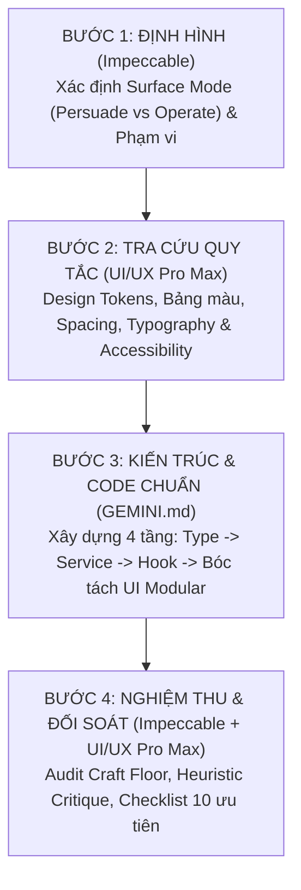

# HƯỚNG DẪN PHỐI HỢP AGENT SKILLS & QUY CHUẨN DỰ ÁN LUXDECOR
# KẾT HỢP: IMPECCABLE + UI/UX PRO MAX + GEMINI.MD (LUXDECOR ARCHITECTURE)

> **CHỈ THỊ CỐT LÕI**:
> Mọi AI Agent làm việc trên dự án này phải nắm vững vai trò của từng công cụ và thực thi chính xác quy trình chuẩn:
> 1. **`Impeccable`**: Đóng vai trò Giám đốc Thiết kế (Design Director) — Định hình chiến lược bề mặt (Modes: `Persuade` vs `Operate`), giữ chuẩn sàn thẩm mỹ (`Craft Floor`), review heuristic (`Critique`).
> 2. **`UI/UX Pro Max`**: Đóng vai trò Kiến trúc sư Trải nghiệm & Quy tắc (UX/UI Intelligence) — Cung cấp 119 quy tắc trải nghiệm, hệ thống Design Tokens, tỷ lệ tương phản, touch targets, spacing và các mẫu biểu đồ/component chuẩn mực.
> 3. **`GEMINI.md`**: Đóng vai trò Bộ luật Kiến trúc Bắt buộc (System Architecture & Law) — Bắt buộc cấu trúc 4 tầng phân lập, Viewport fit 100vh, Zero Dummy Data (`FieldCell`), cấm code rác, form tiền tệ chuẩn.

---

## I. MA TRẬN PHÂN VAI & QUY TRÌNH 4 BƯỚC PHÁT TRIỂN TÍNH NĂNG

Mỗi khi nhận yêu cầu tạo mới hoặc tinh chỉnh bất kỳ giao diện nào, Agent phải tuân thủ nghiêm ngặt 4 bước:



---

### BƯỚC 1: ĐỊNH HÌNH BỀ MẶT (SURFACE SHAPING - IMPECCABLE)
Trước khi viết bất kỳ dòng mã nào, phải xác định rõ màn hình thuộc phân hệ và **Mode** nào:

| Phân hệ / Bề mặt | Mode | Mục tiêu cốt lõi | Nguyên tắc thiết kế |
| :--- | :--- | :--- | :--- |
| **Storefront (B2C)**<br/>*(Home, Products, Detail, Cart, Checkout)* | **`Persuade`** | Thu hút khách hàng, kích thích đặt mua, tin cậy về thương hiệu. | Hình ảnh phối cảnh nội thất sang trọng, typography có điểm nhấn, hiệu ứng hover tinh tế, micro-interactions mượt mà, tích hợp tư vấn AI trực quan. |
| **Admin Panel**<br/>*(Dashboard, Orders, Products, Users, Settings)* | **`Operate`** | Giúp nhân viên hoàn thành tác vụ nhanh, chính xác, không nhầm lẫn. | **Viewport Fit 100vh** (không cuộn toàn trang), bảng Antd cuộn nội bộ, tỷ lệ quét thông tin cao, màu sắc trung tính, rõ ràng, CRUD trong Modal/Drawer. |
| **Chi tiết tài liệu / Hóa đơn**<br/>*(Order Invoice, Terms, Guides)* | **`Read`** | Người dùng tiếp nhận và thấu hiểu dữ liệu logic. | Bố cục phân đoạn mạch lạc, kiểu chữ dễ đọc, phân cấp heading rõ ràng. |

---

### BƯỚC 2: HỆ THỐNG THIẾT KẾ & QUY TẮC UX (UI/UX PRO MAX)
Tra cứu các hướng dẫn tại [`.agents/skills/ui-ux-pro-max/references/`](file:///E:/FW/noithatweb/.agents/skills/ui-ux-pro-max/references):
1. **Bảng màu & Tone nội thất**:
   - Chủ đạo: Tông màu ấm áp, sang trọng của gỗ, đá và kim loại (Warm stone, Amber, Slate, Neutral off-white).
   - Nền Admin: Trắng/Xám sáng nhẹ (`bg-stone-50`, card `bg-white` bóng nhẹ), tương phản chữ tối thiểu **4.5:1** (WCAG AA).
2. **Khoảng cách & Nhịp điệu (Spacing & Layout)**:
   - Áp dụng hệ lưới 8px (`gap-2`, `gap-4`, `gap-6`, `p-4`, `p-6`).
   - Touch Target: Mọi nút bấm, icon thao tác trên mobile phải đạt tối thiểu **44×44px**.
3. **Typography**:
   - Sử dụng font hiện đại, rõ ràng; body text tối thiểu `14px` (Admin) và `15px-16px` (Storefront); line-height tiêu chuẩn `1.5`.

---

### BƯỚC 3: KIẾN TRÚC CODE 4 TẦNG & BÓC TÁCH MODULAR (GEMINI.MD)
Tuyệt đối không gộp chung logic vào một file Page dài. Phải phân rã nghiêm ngặt theo 4 tầng:

```
src/features/<feature_name>/
├── hooks/
│   └── use<Feature>.ts            # TẦNG 3: React Query (useQuery, useMutation) + toast
├── components/
│   ├── <Feature>Table.tsx         # TẦNG 4A: Bảng dữ liệu có scroll nội bộ và phân trang
│   ├── <Feature>Filters.tsx       # TẦNG 4A: Bộ lọc tìm kiếm tách rời
│   ├── <Feature>Modal.tsx         # TẦNG 4A: Form tạo/sửa đặt trong Modal/Drawer
│   └── <Feature>StatsCards.tsx    # TẦNG 4A: Các thẻ chỉ số thống kê
└── pages/
    ├── Admin<Feature>Page.tsx     # TẦNG 4B: Pure Page (chỉ kết nối Hook với Components)
    └── Admin<Feature>DetailPage.tsx # TẦNG 4B: Màn hình chi tiết độc lập
```

#### Quy chuẩn bắt buộc tại từng tầng:
- **Tầng 1 (Types - `src/types/`)**: Khai báo rõ ràng Request params, Response DTOs. Không dùng `any`.
- **Tầng 2 (Services - `src/services/v1/`)**: Class kế thừa `instanceBE`. Không chứa code React hay UI.
- **Tầng 3 (Hooks - `features/.../hooks/`)**:
  - Quản lý cache và mutation qua `@tanstack/react-query`.
  - Mọi thông báo `toast.success`, `toast.error` **bắt buộc** nằm trong `onSuccess` / `onError` của Hook. Không gọi `toast` rải rác ngoài page.
- **Tầng 4 (Components & Pages)**:
  - Dùng `useMemo` cho columns, data lọc, queryParams.
  - Dùng `useCallback` cho các handler truyền xuống con.
  - Quản lý form bằng `react-hook-form` hoặc Antd `Form`.

---

### BƯỚC 4: NGHIỆM THU & SÀN CHẤT LƯỢNG (CRAFT FLOOR & AUDIT)
Trước khi bàn giao code, Agent phải rà soát theo danh sách kiểm tra sau:

1. **Craft Floor (Impeccable `craft-floor.md`)**:
   - Không viền thô cứng, không drop-shadow đậm màu đen xì; dùng viền `border-slate-200` và shadow mờ tinh tế.
   - Không dùng Emoji làm icon giao diện; bắt buộc dùng SVG icon chuẩn (`lucide-react`, `@ant-design/icons`, `@tabler/icons-react`).
2. **Pre-delivery Checklist (UI/UX Pro Max `pro-rules.md`)**:
   - Trạng thái phản hồi: Đầy đủ Loading (`Skeleton`/`Spin`), Empty state (`Empty`), Error feedback rõ ràng.
   - Không bị tràn layout ngang (Horizontal scroll), không co giật khung hình khi dữ liệu load xong (CLS < 0.1).
3. **Quy chuẩn thực tế (GEMINI.md)**:
   - Kiểm tra xem có bất kỳ fallback inline kiểu `name || 'Khách'` nào không. Nếu có, lập tức thay bằng `FieldCell`.

---

## II. BẢNG SO SÁNH QUY CHUẨN ĐÚNG - SAI (DO'S & DON'TS)

| Hạng mục | ❌ NGHIÊM CẤM (Anti-patterns) | ✅ BẮT BUỘC TUÂN THỦ (LuxDecor Standard) |
| :--- | :--- | :--- |
| **Xử lý dữ liệu trống** | `row.name \|\| 'Khách vãng lai'`<br/>`category \|\| 'Nội thất chung'` | Sử dụng `<FieldCell value={row.name} />`<br/>Hàm `isInvalid` sẽ tự động render `-` màu `text-slate-400`. |
| **Thẻ hình ảnh** | `src={url \|\| '/placeholder.png'}` | `src={row.imageUrl}` trực tiếp, kết hợp fallback của Antd `Image` nếu cần. |
| **Bố cục trang Admin** | Toàn bộ trang cuộn dài 2000px, cuộn chuột mỏi tay. | Viewport Fit 100vh: `h-full flex flex-col min-h-0 overflow-hidden`. Bảng cuộn nội bộ `scroll={{ y: 'calc(100vh - 280px)', x: 'max-content' }}`. |
| **Phân trang dữ liệu** | Render 50 - 100 hàng dữ liệu dàn trải gây lag. | Bắt buộc dùng Antd `Pagination`: `pageSize: 8, showSizeChanger: true, pageSizeOptions: ['8', '15', '30']`. |
| **Nhập liệu số tiền** | Dùng `<Input type="text" />` gõ số thông thường. | Dùng `<InputNumber />` của Antd kết hợp `formatter` và `parser` phân cách hàng nghìn (ví dụ: `1,500,000 ₫`). |
| **Trang chi tiết thực thể** | Mở một modal popup bé xíu chứa chi tiết đơn hàng phức tạp. | Tạo trang độc lập `/admin/<resource>/:id` có `UBreadcrumb`, khối thông tin thẻ Card trắng dùng `<FieldCell />` và bảng liên kết bóc tách riêng. |
| **Thông báo kết quả (Toast)** | Viết `axios.post(...).then(() => toast.success(...))` ngay trong file component UI. | Đóng gói mutation trong Hook tại Tầng 3; UI page chỉ gọi `mutate()`. |

---

## III. CÁC LỆNH SKILL THƯỜNG DÙNG VÀ KHI NÀO KÍCH HOẠT

### 1. Nhóm lệnh Impeccable
- `/impeccable shape <tên-tính-năng>`: Kích hoạt khi cần lên kế hoạch chi tiết, phỏng vấn nhu cầu và cấu trúc trải nghiệm trước khi viết code cho tính năng mới.
- `/impeccable document`: Kích hoạt khi cần phân tích codebase thực tế để cập nhật hệ thống thiết kế `DESIGN.md`.
- `/impeccable critique <đường-dẫn-file>`: Kích hoạt khi hoàn thành một UI để chấm điểm mức độ hoàn thiện, phát hiện lỗi viền, màu sắc, tương phản và khoảng cách thừa thiếu.
- `/impeccable doctor`: Kiểm tra tính đồng bộ giữa các file cấu hình và artifacts của Impeccable.

### 2. Nhóm lệnh & Tài liệu UI/UX Pro Max
- Tra cứu nhanh 119 quy tắc trải nghiệm: Tham khảo trực tiếp [`quick-reference.md`](file:///E:/FW/noithatweb/.agents/skills/ui-ux-pro-max/references/quick-reference.md).
- Checklist nghiệm thu giao diện: Tham khảo [`pro-rules.md`](file:///E:/FW/noithatweb/.agents/skills/ui-ux-pro-max/references/pro-rules.md).
- Tra cứu bảng màu và style nội thất: Tham khảo thư mục [`data/`](file:///E:/FW/noithatweb/.agents/skills/ui-ux-pro-max/data).

---

## IV. TÀI LIỆU VÀ NGUỒN THAM CHIẾU
1. **Quy chuẩn kiến trúc**: [`GEMINI.md`](file:///E:/FW/noithatweb/GEMINI.md)
2. **Hồ sơ sự thật sản phẩm**: [`PRODUCT.md`](file:///E:/FW/noithatweb/PRODUCT.md)
3. **Cấu hình Impeccable**: [`.impeccable/config.json`](file:///E:/FW/noithatweb/.impeccable/config.json)
4. **Kho kỹ năng**: [`.agents/skills/`](file:///E:/FW/noithatweb/.agents/skills)
